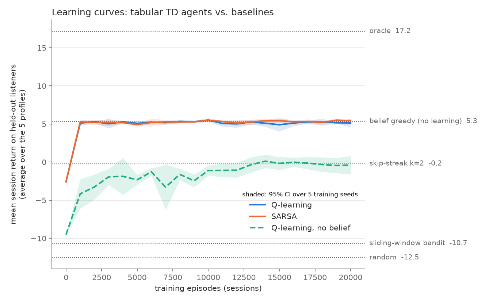

# Adaptive Music Queue: Reinforcement Learning for Session-Aware Song Recommendation

**CS5100: Foundations of Artificial Intelligence, Group 3**

Jiang Aitong · Shloka Shreyans Trivedi · Aryan Rakeshbhai Shah

---

## Overview

Listeners' preferences often change within a single session. A static recommender can keep suggesting similar songs even after the listener has skipped several in a row. This project builds an **adaptive next-song queue** that learns from:

- **Implicit feedback:** early skips, completions, replays
- **Explicit feedback:** likes

The goal is to improve **session-level satisfaction** while balancing familiar music, discovery, and coherent transitions between songs. The main challenge is telling apart a listener **rejecting one specific track** from a listener **temporarily shifting** their preferred genre, mood, or energy.

## Background

| Approach | Idea | Limitation |
|---|---|---|
| Content-based filtering | Rank songs by metadata similarity | Doesn't adapt within a session |
| Collaborative filtering | Use patterns across many listeners | Needs large interaction data |
| Contextual bandits | Adapt to immediate feedback | Doesn't optimize long-term sequences |
| Reinforcement learning | Treat recommendation as sequential decisions | The approach this project explores |

This project is a **small, inspectable, session-aware agent trained from scratch**. It is not a full music streaming platform.

## Existing Methodologies

This section surveys the main families of approaches to music and sequential recommendation, roughly in order of how much they account for the *sequential, interactive* nature of a listening session. For each one we note what it means for this project.

### 1. Content-Based Filtering

Content-based recommenders represent each item by its attributes and recommend items similar to those the user has liked before [2]. In music, the attributes are typically genre and artist tags or audio descriptors such as tempo, energy, valence, danceability and acousticness. Deep models can also learn these representations directly from audio, which helps with the *cold-start* problem for new tracks that have no listening history [3]. Many classical automatic playlist generators work this way: they order tracks so that neighboring songs are acoustically similar, which keeps transitions smooth [4].

*Strengths:* it needs no data from other users, it works on a small catalog, and it is easy to interpret.
*Limitations:* it is static and tends to over-specialize (a "filter bubble"). It has no built-in way to react when a user skips several similar tracks in a row.
*Relevance:* our track metadata and audio features will define the similarity space. A content-similarity recommender is one of our **baselines**.

### 2. Collaborative Filtering

Collaborative filtering (CF) infers preferences from patterns across many users. Matrix factorization learns latent user and item vectors whose dot product predicts preference [6]. Because music data is mostly *implicit* (plays, skips) rather than explicit ratings, the implicit-feedback formulation of Hu et al. [5] treats play counts as confidence-weighted observations, and it became the standard approach for music. Surveys of music recommender systems point out problems specific to music: very large catalogs, short item duration, lots of repeated listening, and strong dependence on context [7].

*Strengths:* it captures taste that metadata cannot describe, and it scales well.
*Limitations:* it needs large interaction datasets. The classical form models long-term taste and ignores order and context within a session.
*Relevance:* with no real user population, we will not train CF directly. However, the idea of a **long-term preference profile** carries over to our listener state.

### 3. Session-Based and Sequential Recommendation

Session-based recommenders predict the next item from the sequence of the current session. GRU4Rec [8] was the first to apply recurrent neural networks to this task. SASRec [9] later used self-attention to model which past items matter for the next one. At Spotify, CoSeRNN [11] showed that recent consumption and session context (time of day, device) predict what a user streams next, and it models a user as a *sequence of session-level embeddings*. This matches the long-term vs. short-term split in our design. A large benchmark study by Ludewig and Jannach [10] found that simple nearest-neighbor and rule-based session methods often match or beat deep models.

*Strengths:* they model order and short-term intent explicitly.
*Limitations:* these are *supervised predictors* of the next item. They imitate logged behavior rather than choose actions that optimize future feedback, and they need large logs to train.
*Relevance:* [10] supports keeping strong **heuristic baselines** (e.g., "after k skips, switch genre"). Our session state can borrow the recent-history representation these models use.

### 4. Multi-Armed and Contextual Bandits

Bandit algorithms address the **exploration–exploitation** trade-off directly. Contextual bandits such as LinUCB [12] choose an arm (item) based on a context vector and update after each reward. Thompson sampling [13] is a Bayesian alternative that performs well in practice. In music, Wang et al. [14] framed interactive music recommendation as a bandit problem with a Bayesian model that combines audio content with a **novelty** term, so recently played songs lose value and recover over time. Spotify's BaRT [15] used contextual bandits in production to decide when to explore versus exploit on the home page.

A key point for us is **non-stationarity**. Standard bandits assume fixed reward distributions, but a listener whose mood changes mid-session violates that assumption. Discounted-UCB and sliding-window UCB [16] down-weight older observations so they can track rewards that change abruptly.

*Strengths:* they adapt online, explore in a principled way, are sample-efficient, and are simple to implement.
*Limitations:* they are *myopic*. They maximize immediate reward and do not reason about how the current song changes future states (e.g., a "bridge" song that sets up a style transition).
*Relevance:* a contextual bandit, possibly with a sliding window, is a natural **intermediate baseline** between heuristics and full RL. Comparing them tells us whether planning over multiple steps adds anything.

### 5. Reinforcement Learning and MDP-Based Recommenders

Treating recommendation as a Markov Decision Process goes back at least to Shani et al. [17], who used n-gram purchase histories as states and solved for a policy that maximizes long-term value. The general machinery (value functions, temporal-difference learning, Q-learning [18]) is covered in Sutton and Barto [1]. Afsar et al. [22] survey modern RL-based recommenders. Notable examples include:

- **DEERS** [19], which models positive and negative feedback (e.g., skips) as *separate* state components. This idea fits our problem directly, because skips far outnumber likes and could otherwise drown out the positive signal.
- **Top-K off-policy REINFORCE** [20], from YouTube, which trains a policy-gradient recommender from logged data with importance-weight correction.
- **SlateQ** [21], which decomposes the value of a recommended *set* into per-item Q-values, making large action spaces tractable.

Hierarchical RL, in particular the *options* framework [34], lets an agent choose temporally extended actions such as "stay in this style" or "transition toward style X" and then pick specific tracks within them. This is the hierarchical decision-making described in our proposal.

*Strengths:* they optimize **long-term, session-level** reward and can learn to take a short-term loss for a later gain.
*Limitations:* they need many interactions, the state and action spaces can grow large, and evaluating them offline is hard.
*Relevance:* our tabular or approximate Q-learning agent belongs here. A small catalog, short sessions and a simulator keep the problem tractable without deep RL.

### 6. Reinforcement Learning for Music Playlists

Two papers are closest to this project:

- **DJ-MC** [23] formulates playlist generation as an MDP whose reward depends on both the individual song *and the transition* from previous songs. Using song features and model-based planning, it learns personalized sequences within a **single 25–50 song session** and outperforms recommenders that score songs independently. The scale and setting are close to ours, so this is the most direct precedent.
- **Spotify's simulation-based RL** [24] trains a modified DQN (AH-DQN) against a *learned user simulator* to generate playlists. It shows that simulator-based offline evaluation correlates with online A/B results. This supports our decision to train and evaluate against simulated listeners.

### 7. Skip Behavior and Implicit Feedback

Skips are the main implicit signal in music streaming. The **Music Streaming Sessions Dataset** [25] (~160M Spotify sessions with skip labels and audio features) was released for the **Spotify Sequential Skip Prediction Challenge** at the WSDM Cup 2019 [26]. That challenge asked participants to predict whether each remaining track in a session would be skipped, given the first half of the session. Meggetto et al. [27] applied deep RL to skip prediction and found that *user-behavior features* (recent skip patterns) predict skips much better than content or context features.

*Relevance:* this supports giving **recent skip/complete history** a central role in our state. It also shows that skip timing matters (an early skip is a stronger negative signal than a late one), which we can use when designing the reward.

### 8. User Simulators for Training and Evaluation

Since online experiments with real users are expensive, simulators have become standard tools for RL recommenders. **RecSim** [28] (Google) is a configurable platform with pluggable user-choice models, latent user state and document models. **RecoGym** [29] simulates organic and bandit feedback for e-commerce recommendation. Both use the same design pattern we need: a hidden user state (e.g., current mood or energy preference) that generates observable feedback and can change over time.

*Relevance:* our listener simulator follows this design. Its profiles have a long-term taste vector, a short-term mood that can **shift mid-session**, and a stochastic feedback model (skip / complete / replay / like).

### 9. Diversity, Novelty, and Repetition

Optimizing for accuracy alone leads to repetitive recommendations. Maximal Marginal Relevance [30] and topic diversification [31] re-rank candidates to balance relevance against redundancy. Kaminskas and Bridge [32] survey "beyond-accuracy" objectives (diversity, novelty, serendipity, coverage). In music, Hansen et al. [33] show that recommendations can shift users toward more diverse listening without hurting satisfaction.

*Relevance:* this motivates our **repetition penalty** and **exploration** terms, and gives us beyond-accuracy metrics (intra-session diversity, novelty) to report alongside skip rate.

### Summary and Research Gap

| Family | Adapts within session | Plans ahead | Explores | Data needs | Example refs |
|---|:---:|:---:|:---:|---|---|
| Content-based | ✗ | ✗ | ✗ | Low (metadata only) | [2], [3], [4] |
| Collaborative filtering | ✗ | ✗ | ✗ | High (many users) | [5], [6] |
| Session-based sequential | ✓ | ✗ | ✗ | High (logged sessions) | [8], [9], [10], [11] |
| Contextual bandits | ✓ | ✗ | ✓ | Low–medium | [12]–[16] |
| RL / MDP | ✓ | ✓ | ✓ | Medium–high (or a simulator) | [17]–[24] |

Most existing work either optimizes long-term taste with large proprietary datasets or predicts skips without acting on the prediction. Bandits adapt quickly but plan only one step ahead. Large-scale RL systems ([20], [24]) depend on infrastructure and data beyond the scope of a course project. The gap this project targets is a **small, inspectable agent** that explicitly separates:

1. *rejection of a single track*, which calls for staying in the same style with a different song, from
2. *a shift in the listener's mood or style*, which calls for a transition,

and is tested against controlled simulated listeners whose ground-truth preference shifts are known. This makes it possible to measure adaptation directly, which real logged data does not allow.

## Scope

**Minimum scope:**

- A catalog of **~1,000–2,000 tracks** with genre and audio-feature metadata, downsampled from the Spotify Tracks Dataset [35]
- Simulated listening sessions of **15–30 recommendations**
- Tracking of short-term feedback and a longer-term preference profile
- Choosing the next track from a limited candidate set
- Reacting to repeated skips, avoiding too much repetition, and sometimes exploring unfamiliar styles
- Several configurable **simulated listener profiles**, including ones whose preferences change during a session
- A lightweight **interactive demo** where a user gives feedback by hand

**Out of scope:** audio streaming integration.

## Project Structure

```
adaptive-music-queue/
├── data/
│   ├── data.csv          # 2,000-track sample from the Spotify Tracks Dataset
│   ├── catalog.csv       # data.csv + style cluster per track (read by all experiments)
│   └── clusters.csv      # cluster centroids, sizes, descriptions, nearest neighbors
├── scripts/
│   ├── get_data.py       # download, clean, deduplicate and sample → data/data.csv
│   ├── cluster.py        # k-means style clusters → data/catalog.csv, data/clusters.csv
│   └── train_agents.py   # train + evaluate agents → results/, figures/learning_curves.png
├── amq/                  # the project package
│   ├── catalog.py        # Catalog: tracks, features, clusters, similarity
│   ├── simulator.py      # ListenerEnv: HMM listener simulator, 5 profiles, reward
│   ├── selector.py       # Macro-actions and the low-level track selector
│   ├── belief.py         # BeliefFilter: HMM forward filter over the hidden style
│   ├── state.py          # StateEncoder: belief + recent feedback → one of 216 states
│   ├── agents.py         # TDAgent: tabular Q-learning and SARSA over macro-actions
│   ├── bandit_baselines.py  # random and sliding-window bandit baselines
│   └── evaluate.py       # episode runner, training loop, reference agents
├── tests/                # python -m unittest discover tests
│   ├── test_simulator.py
│   ├── test_selector.py
│   ├── test_belief.py
│   ├── test_agents.py
│   └── test_bandit_baselines.py
├── baselines.py          # early content-similarity and skip-streak baselines
├── results/              # learning_curves.csv, final.csv, summary.md
├── figures/
│   ├── clusters.png      # PCA view of the clusters and genre-by-cluster heatmap
│   └── learning_curves.png  # TD agents vs. baselines on held-out listeners
├── requirements.txt
└── README.md
```

## Dataset

We use the **Spotify Tracks Dataset** [35] ([Hugging Face](https://huggingface.co/datasets/maharshipandya/spotify-tracks-dataset), [Kaggle](https://www.kaggle.com/datasets/maharshipandya/-spotify-tracks-dataset)). It has ~114,000 tracks across 114 genre labels (~1,000 tracks per genre) and is released under a BSD license. Each row contains:

| Group | Columns | Used for |
|---|---|---|
| Identity | `track_id`, `track_name`, `artists`, `album_name` | Deduplication, display, artist-repeat penalty |
| Audio features | `danceability`, `energy`, `valence`, `acousticness`, `instrumentalness`, `speechiness`, `liveness`, `loudness`, `tempo` | Similarity space, style clusters, simulator preferences |
| Musical | `key`, `mode`, `time_signature` | Optional transition-smoothness features |
| Metadata | `track_genre`, `popularity`, `duration_ms`, `explicit` | Cluster sanity checks, familiarity vs. discovery |

**Downscaling to 2,000 tracks** (`scripts/get_data.py` → `data/data.csv`):

1. **Clean.** Drop rows with missing values, tracks shorter than 1 min or longer than 10 min, zero-tempo tracks (tempo 0 means missing), and spoken word (`speechiness` > 0.66). Exclude the non-music genres comedy, sleep, kids and children.
2. **Deduplicate.** The same song can appear under several `track_id`s (single vs. album release), and the same `track_id` under several genres. Group by normalized `track_name` + `artists`, keep the most popular release, and merge all of its genre labels into `genres`.
3. **Normalize.** Scale `tempo` and `loudness` to [0, 1] using the 1st–99th percentiles, so that a few extreme tracks don't squash the rest into a narrow range. The other audio features are already in [0, 1].
4. **Select 15 genres** spread across the audio-feature space: acoustic, ambient, classical, country, edm, hip-hop, jazz, latin, metal, opera, pop, r-n-b, rock, techno, trip-hop. **Stratify-sample ~133 tracks per genre** across popularity terciles, so each genre has both familiar and obscure tracks (seed 50). A track tagged with several sampled genres is picked at most once.

**Style clusters** (`scripts/cluster.py` → `data/catalog.csv`, `data/clusters.csv`, `figures/clusters.png`):

5. **Choose features.** Cluster on 7 style features: `danceability`, `energy`, `valence`, `acousticness`, `instrumentalness`, `speechiness`, `tempo`. `liveness` is left out because it detects an audience in the recording rather than the style of the song. `loudness` is left out because it is strongly correlated with `energy` (r = 0.83) and would count the energy axis twice. Both columns stay in the catalog.
6. **Run *k*-means with *K* = 8** (50 restarts, seed 0). Clusters are renumbered by centroid energy (0 = calmest, 7 = most intense) so that the ids are readable. `python scripts/cluster.py --sweep` prints the model-selection table for *K* = 5–14. *K* = 8 has the most stable clustering across seeds (pairwise ARI 0.99) with balanced sizes (175–389) and silhouette 0.25. Larger *K* drops below 0.85 stability and starts producing very small clusters.
7. **Check against genres.** Audio features only partly recover genre labels (NMI ≈ 0.24 for every *K*). This is expected, since pop, rock, latin and edm overlap heavily in audio space. The clusters are coherent *styles* that cut across genre names, which is what the listener's mood is about:

   | Cluster | Tracks | Artists | Main genres | Character |
   |:---:|---:|---:|---|---|
   | 0 | 225 | 119 | classical, ambient, opera | Instrumental, acoustic, calm |
   | 1 | 214 | 144 | opera, jazz, acoustic | Acoustic vocal, slow, low energy |
   | 2 | 194 | 167 | acoustic, opera, jazz | Acoustic, faster tempo |
   | 3 | 228 | 176 | r-n-b, jazz, pop | Mellow, positive, semi-acoustic |
   | 4 | 175 | 129 | techno, trip-hop, ambient | Electronic instrumental, dark |
   | 5 | 313 | 252 | metal, edm, country | Energetic, dark, mid-tempo |
   | 6 | 389 | 272 | latin, edm, hip-hop | Happy, danceable |
   | 7 | 262 | 208 | metal, latin, country | Fast, high energy |

   `data/clusters.csv` stores each centroid μ<sub>*z*</sub> (used by the simulator's sim(*x*, μ<sub>*z*</sub>)) and each cluster's nearest neighbor (the `BRIDGE` target).
8. **Freeze the catalog.** `data/catalog.csv` is `data/data.csv` plus a `cluster` column. All experiments read this file. Both scripts use fixed seeds, and rerunning `scripts/cluster.py` reproduces it byte for byte.

**Balance checks (no further resampling needed):**

- *Cluster sizes* differ by about 2× (175–389). We keep this rather than rebalance, since the differences reflect real density in audio space. Even the smallest cluster can fill 6+ full sessions without repeating a track, and every cluster has at least 31 tracks in each popularity band (≤ 20, 21–50, > 50), so `STAY` never runs out of familiar or obscure options. Two implications for the code: the listener profile *w* is defined over *clusters*, so cluster size does not bias it; and the random baseline samples tracks uniformly, so it lands in cluster 6 about 19% of the time.
- *Artist concentration* is low. There are 1,098 distinct main artists, and only 12 have 10 or more tracks. The most concentrated cluster is 0 (Mozart, 29 of 225 tracks, 13%), but it still has 119 distinct artists, so the "no artist repeat within 5 tracks" rule can always be satisfied. No artist cap is applied.

**Reproduce:**

```bash
pip install -r requirements.txt
python scripts/get_data.py    # downloads from Hugging Face, writes data/data.csv
python scripts/cluster.py     # writes data/catalog.csv, data/clusters.csv, figures/clusters.png
```

## AI Formulation

The listener's current taste (their mood, or the style they want right now) is **hidden**. The system only sees feedback such as skips, completions and likes. That makes this a **partially observable** sequential decision problem, i.e. a POMDP [37]. We handle it in the standard way from the course: maintain a **belief** over the hidden state using an **HMM forward filter** [36], then learn a policy over a compact, discretized belief state with **temporal-difference RL**. This structure is also how we address the project's core question. Under the HMM, a single skip of a track the listener simply dislikes barely changes the belief, while a *run* of skips inside one style moves probability mass to other styles. That is how the agent can tell **track rejection** apart from a **preference shift**.

### Environment: HMM Listener Simulator

Each simulated listener is itself a hidden Markov model:

- **Hidden state** *z<sub>t</sub>* ∈ {1, …, *K*}: the style cluster the listener currently wants.
- **Long-term profile** *w*: a distribution over clusters giving the listener's broader taste.
- **Transition model:** *z<sub>t+1</sub>* = *z<sub>t</sub>* with probability 1 − ρ. Otherwise it switches to a cluster drawn from *w*. Some profiles instead have a scheduled abrupt shift at a fixed step.
- **Emission model:** the probability of a positive response to track *x* is a logistic function of its fit, P(listen | *x*, *z*) = σ(β · sim(*x*, μ<sub>*z*</sub>) + λ · popularity(*x*) − η · fatigue(*x*) + *b*). Here μ<sub>*z*</sub> is the cluster centroid and fatigue counts recent repeats of the same track or artist. Thresholds on a noisy draw map this probability to one of **early skip / late skip / complete / like / replay**.
- **Track-specific dislikes:** each listener has a random set of tracks (~10%) they skip *regardless* of mood. This creates the ambiguity the agent has to resolve.

| Profile | ρ (switch rate) | Behavior |
|---|---|---|
| Stable | ≈ 0 | One preferred style for the whole session |
| Drifter | 0.05–0.10 | Gradually wanders between neighboring styles |
| Abrupt shifter | scheduled | Switches style at a fixed step (e.g., step 10 of 25) |
| Picky | ≈ 0 | High track-specific dislike rate, so many isolated skips that are *not* shifts |
| Explorer | 0.10 | Rewards novelty and low-popularity tracks |

### MDP Components (Agent's View)

**Belief update** (`amq/belief.py`). After each recommendation, the agent updates its belief with the HMM forward algorithm [36]. The hidden style *z<sub>t</sub>* judges track *t* and switches happen between tracks, so each step is an update followed by a prediction:

- *update:* post<sub>t</sub>(*z*) ∝ *b<sub>t</sub>*(*z*) · P(feedback<sub>t</sub> | *x<sub>t</sub>*, *z*)
- *predict:* *b<sub>t+1</sub>*(*z'*) = Σ<sub>*z*</sub> post<sub>t</sub>(*z*) · P(*z'* | *z*)

The agent acts on *b<sub>t+1</sub>*, its belief about the style that will judge the *next* track. The prior *b*<sub>0</sub> is uniform.

The agent uses its own approximate listener model (`ListenerModel`), not the simulator's true parameters:

| Part | Agent's model | Default |
|---|---|---|
| Transition | Stay with prob 1 − ρ̂, else switch uniformly to one of the other *K* − 1 clusters (the agent does not know *w*) | ρ̂ = 0.05 |
| Emission | P(fb \| *x*, *z*) = *d̂* · P<sub>dislike</sub>(fb) + (1 − *d̂*) · OrderedLogit(fb \| β̂ · sim(*x*, μ<sub>*z*</sub>) + *b̂*) | β̂ = 6, *b̂* = −3, *d̂* = 0.1 |

The emission has the same form as the simulator's, but without the popularity, fatigue and novelty terms, which the agent cannot know. The dislike term *d̂* is what separates the two meanings of a skip. Every skip is partly explained by "they just don't like this song," so after four likes in a cluster a single skip leaves the belief's top cluster unchanged, while a run of three more skips moves it (tested for every cluster).

*A property of the feedback model:* under an ordered logit, the middle outcome `complete` is not monotone in fit. P(complete) peaks at logit ≈ 1.25 and falls for better-fitting tracks, which tend to get a like or replay instead. So "complete rather than like" is weak evidence of a *moderate* fit, i.e. a neighboring cluster. This is correct inference under the simulator. In practice it makes no difference: a filter that merges all positive outcomes performs the same.

*Sanity check* (100 seeds per profile, mean session return; the policy always plays `FOLLOW_BELIEF`):

| ρ̂ | Stable | Drifter | Abrupt | Picky | Explorer |
|---:|---:|---:|---:|---:|---:|
| 0 | 12.8 | 5.1 | −2.6 | 2.3 | −1.8 |
| **0.05** | **12.5** | **6.3** | **6.5** | **−0.1** | **−0.2** |
| 0.4 | 5.3 | 2.9 | 3.9 | −5.0 | −2.0 |
| *Skip-counting, no belief* (`STAY`; `EXPLORE` after 2 skips) | 5.6 | 3.2 | 1.5 | −5.8 | −5.3 |

Following the belief beats skip counting on every profile. ρ̂ also shows the core trade-off directly. With ρ̂ = 0 the agent never believes a shift happened, so Abrupt collapses. With a large ρ̂ it treats isolated skips as shifts, so Picky collapses.

**State** *s<sub>t</sub>* (`amq/state.py`) is a small discretized tuple, so tabular methods remain feasible: 2 × 3 × 4 × 3 × 3 = **216 states**, of which about two thirds can actually occur.

| Component | Values | Definition |
|---|---|---|
| Is the current cluster the belief's argmax? | yes / no | Cluster of the last played track (home cluster before the first) vs. argmax *b<sub>t</sub>* |
| Belief confidence (max *b<sub>t</sub>*) | low / medium / high | Cut at 1/3 and 2/3, close to the 33rd and 67th percentiles seen in simulated sessions |
| Skip streak | 0 / 1 / 2 / 3+ | Consecutive skips just now |
| Last feedback | negative / neutral / positive | Early skip / late skip or complete / replay or like |
| Session phase | early / mid / late | First, middle or last third of the session |

`Last feedback` encodes the *strength* of the last response rather than repeating the skip streak (a non-zero streak already means the last track was skipped). Together they distinguish an early skip from a late one, and a complete from a like.

**Actions** are *hierarchical*: a lightweight version of the options framework [34]. The RL agent chooses one of four **macro-actions**, each naming a target cluster. A deterministic low-level selector (`amq/selector.py`) then picks the concrete track, so all learning happens at the macro level.

| Macro-action | Target cluster | Ties broken by | Purpose |
|---|---|---|---|
| `STAY` | Current cluster (that of the last played track) | none | Exploit: treat the last skip as a one-off track rejection |
| `BRIDGE` | One of the 3 nearest clusters | highest belief → fewest visits → nearest | Smooth, gradual transition |
| `FOLLOW_BELIEF` | argmax *b<sub>t</sub>* | nearest to current (a flat belief means stay) | Follow an inferred preference shift |
| `EXPLORE` | Least-visited other cluster | highest belief → nearest | Discovery, and gathering information |

Agents without a belief (the baselines) can use the same actions: a uniform belief is assumed. The visit-count tie-breaks mean repeated `BRIDGE` moves walk outward instead of bouncing between two neighboring clusters, and repeated `EXPLORE` moves eventually visit every cluster. Before the first track the selector treats the **home cluster** (the one closest to the catalog's average sound, cluster 3) as current.

The **low-level selector** takes only unplayed tracks from the target cluster and moves artists heard in the last 5 tracks to the end of the list. It ranks the rest by distance to an *anchor*: the mean of the tracks the listener responded to positively in that cluster this session, or the cluster centroid if there are none. A typical track also gives the belief filter the clearest evidence about the hidden style. If the target cluster has no unplayed tracks, the nearest cluster that has some is used. The selector reads only the session history and the agent's own belief, never the simulator's ground truth. `Selector.candidates()` returns the top 20 for the demo.

Sanity check (100 seeds per profile, mean session return over 25 tracks): `FOLLOW_BELIEF` given the *true* hidden style scores +10 to +21, always `STAY` scores −13 to −4, and random play scores −15 to −11. The best fixed macro differs by profile (`STAY` for Stable, `BRIDGE` for Explorer), which is the decision the RL agent has to learn.

**Reward** *r<sub>t</sub>*: like +2, replay +1.5, complete +1, late skip −0.5, early skip −1, plus −0.5 for an artist repeat. The weights are configurable and will be tuned once, then frozen.

**Episode:** one session of 20–30 recommendations, with discount γ = 0.9.

### Methods

Every core method maps to course material, so all of it can be built and explained from first principles [1], [38]:

| Component | Method | Course topic |
|---|---|---|
| Listener model and belief | HMM forward filtering | Markov Models, Hidden Markov Models (Oct 5–7) |
| Problem framing | MDP / POMDP with belief state | MDPs, POMDPs (Oct 14–21) |
| Model-based reference | Value iteration on an MDP estimated from simulator rollouts | MDPs; model-based RL (Oct 19–26) |
| **Core learners** | **Tabular Q-learning** [18] and **SARSA** [39] with decaying ε-greedy | TD learning: SARSA and Q-learning (Oct 28) |
| Simulator emission model | Logistic response function | Logistic regression (Nov 9) |
| *Stretch:* function approximation | Linear Q-learning on the continuous belief vector, trained by gradient descent | Gradient descent (Nov 2); Deep RL (Nov 30) |

**Baselines:**

1. **Random:** a random unplayed track.
2. **Content similarity:** always `STAY`, i.e. the nearest unplayed track to the last completed one [2].
3. **Skip-streak heuristic:** switch cluster after *k* consecutive skips, with *k* tuned.
4. **Sliding-window ε-greedy bandit over clusters:** adaptive but myopic [16].
5. **Oracle:** knows the true hidden *z<sub>t</sub>*. This is an upper bound and is not deployable.

Comparing the agents against baselines 3 and 4 tests the two key claims: that the **HMM belief** beats raw skip counting, and that **multi-step planning** beats myopic adaptation.

**What makes this challenging:** the problem is partially observable, with a deliberately ambiguous signal (one skip can mean two different things). It has delayed credit assignment (an `EXPLORE` or `BRIDGE` step can pay off only several tracks later). It also involves three different solution paradigms: model-based vs. model-free, and on-policy vs. off-policy. Even so, the whole system remains tabular and inspectable.

## Evaluation

**Protocol:** train each agent on the simulator over many sessions (~10k–50k episodes per profile mix). Evaluate on **held-out random seeds**, with exploration turned off. Report mean ± 95% CI over 5 training seeds.

**Metrics:**

| Metric | What it measures |
|---|---|
| Mean session return | Overall satisfaction under the reward function |
| Skip rate / early-skip rate | Direct listener dissatisfaction |
| **Recovery time** | Tracks needed after a true preference shift until the agent recommends from the new style and gets a completion |
| **False-switch rate** | How often the agent leaves the preferred style after an isolated track-specific skip (measured on the Picky profile) |
| Intra-session diversity and repetition | Distinct clusters and artists per session; repeat rate |
| Learning curves | Return vs. training episodes (sample efficiency) |

**Ablations:**

- **Belief vs. no belief:** replace the HMM belief features with the raw skip streak only.
- **Q-learning vs. SARSA:** compare the off-policy and on-policy learners.
- **Planning horizon:** γ ∈ {0, 0.5, 0.9}. With γ = 0 the agent reduces to a myopic, bandit-like learner.
- **Model mismatch:** vary the agent's assumed ρ̂ against the simulator's true ρ.
- **Model-free vs. model-based:** compare Q-learning with value iteration on the estimated MDP.

**Hypotheses:**

- **H1:** Belief-state agents have a lower false-switch rate than the skip-streak heuristic *and* a shorter recovery time than content similarity.
- **H2:** γ > 0 beats γ = 0 on the Abrupt-shifter and Explorer profiles.
- **H3:** Tabular Q-learning gets close to the value-iteration reference on the discretized MDP.

**Interactive demo:** a small CLI or Streamlit app. A person plays the listener, marking each recommended track as skip, complete or like. The app shows the agent's live belief over styles and its chosen macro-action at each step.

## Results (Check-in 2)

`python scripts/train_agents.py` trains tabular Q-learning and SARSA (`amq/agents.py`) for 20,000 sessions on a uniform mix of the five profiles (α = 0.02, γ = 0.9, ε decayed linearly 1.0 → 0.05 over the first 60%), with 5 training seeds each. Every 1,000 sessions it evaluates on held-out listeners with exploration off. Baselines share the same held-out listeners, so all comparisons are paired. The full run takes about 4 minutes with `--jobs 10` (the default of 4 parallel processes takes about 9).



Mean session return (25 tracks) on 200 held-out listeners per profile. Learners: 20000 training episodes, α = 0.02, γ = 0.9, ε 1.0 → 0.05; mean ± 95% CI over 5 training seeds.

| Agent | stable | drifter | abrupt | picky | explorer | **mean** |
|---|---|---|---|---|---|---|
| Q-learning | 12.39 ± 0.53 | 7.34 ± 0.62 | 5.80 ± 0.84 | -0.18 ± 0.53 | 0.47 ± 0.44 | **5.16 ± 0.46** |
| SARSA | 12.51 ± 0.37 | 7.63 ± 0.39 | 5.98 ± 0.20 | 0.09 ± 0.58 | 0.53 ± 0.44 | **5.35 ± 0.15** |
| Q-learning, no belief | 4.85 ± 4.03 | 2.92 ± 1.29 | 0.62 ± 0.91 | -5.19 ± 2.11 | -4.58 ± 0.71 | **-0.28 ± 1.35** |
| random | -11.95 | -10.76 | -12.30 | -14.36 | -13.29 | **-12.53** |
| content similarity (STAY) | -3.87 | -2.65 | -5.50 | -8.57 | -14.37 | **-6.99** |
| skip-streak k=2 | 5.11 | 3.02 | 1.26 | -5.88 | -4.56 | **-0.21** |
| sliding-window bandit | -9.49 | -9.06 | -10.21 | -12.77 | -11.78 | **-10.66** |
| belief greedy (no learning) | 12.55 | 7.61 | 6.41 | -0.23 | 0.38 | **5.34** |
| oracle | 19.77 | 20.73 | 20.89 | 10.08 | 14.41 | **17.18** |

**What the numbers say:**

- **The HMM belief is the decisive ingredient.** With the belief, both learners reach about +5.3 per session. The same Q-learner without it (state = skip streak, last feedback and phase only) reaches −0.3, no better than the hand-written skip-streak rule (−0.2). That is about +5.5 per session from the belief alone, consistent across all five profiles.
- **Learning is fast.** Both belief-based learners reach their plateau within the first 1,000 sessions. SARSA is slightly more stable across training seeds (CI ±0.15 vs. ±0.46), consistent with its more cautious on-policy updates.
- **RL does not yet beat simply following the belief** (5.35 vs. 5.34). The learned policy is sensible: `STAY` when the belief is confident and agrees with the current cluster, `EXPLORE` when uncertain early in the session, `BRIDGE` after a run of skips. But 86–93% of its picks are the same track `FOLLOW_BELIEF` would choose. When the current cluster is the belief's top cluster, `STAY` and `FOLLOW_BELIEF` coincide, and the remaining deviations gain too little to show. So far, multi-step planning (hypothesis H2) is **not** supported.
- **The gap to the oracle (17.2) is about inference, not action choice.** The oracle uses the same selector and the same `FOLLOW_BELIEF` action, just with the true style. Closing the gap means getting to the right style faster.
- **Myopic and static baselines do poorly.** The sliding-window bandit (−10.7) is close to random (−12.5). It picks a random track within its chosen cluster rather than using the shared selector, and its 10-step window is short for a 25-track session. Always `STAY` (−7.0) cannot react to shifts.

**Next steps:** see the [Project Tracker](#project-tracker) for the task list with owners and internal deadlines.

## Project Tracker

Course deadlines: Check-in 2 on **Nov 20**, TA demo and walkthrough in the last week of classes (**Dec 7–11**), final deliverables on **Dec 11**. Internal deadlines below finish all code and experiments by **Dec 4**, leaving **Dec 5–11** for the final report, slides and walkthrough.

### Contributions to date

Everything below can be checked against the commit history and pull requests on GitHub. Each member should add work done outside the repository (proposal and check-in writing, meetings, slides).

**Shloka Shreyans Trivedi**

- **Dataset sample** (PR #5, Nov 3; `scripts/get_data.py`, `data/data.csv`)
  - Loads the Spotify Tracks dataset (~114k tracks) and drops rows with missing names, artists, genres or audio features.
  - Merges duplicate releases of the same song: keeps the most popular release and the union of all its genre labels.
  - Removes excluded genres and rescales tempo and loudness to [0, 1] using the 1st–99th percentiles.
  - Draws a reproducible stratified sample: 2,000 tracks over 15 genres, each split evenly across popularity terciles (seed 50).
- **Catalog interface** (PR #7, Nov 16; `amq/catalog.py`, `amq/__init__.py`)
  - `Catalog` dataclass: track features, cluster labels, centroids, popularity, artist ids, cluster members and centroid distances.
  - Defines the style-fit score `similarity(x, z) = 1 − ‖x − μ_z‖` that the simulator and the agent both use.
- **HMM listener simulator** (PR #7, Nov 16; `amq/simulator.py`)
  - `Feedback` enum with five ordered outcomes.
  - Ordered-logit feedback model (`feedback_probs`, cut-points −1, 0, 2.5, 3.5).
  - `ListenerProfile` and the five profiles: Stable, Drifter (neighbour switches), Abrupt (forced switch at track 10), Picky (30% dislikes) and Explorer.
  - Per-listener Dirichlet taste vector, a hidden style path pre-sampled at `reset(seed)`, and dislike lists.
  - Emission logit with style-fit, popularity, fatigue and cluster-novelty terms.
  - `RewardConfig` (feedback rewards plus the artist-repeat penalty), and `ListenerEnv.reset`/`step`, which return ground truth for metrics in `StepResult.info`.
- **Simulator tests** (PR #7; `tests/test_simulator.py`, 20 tests): feedback probabilities, profile behaviour, reproducibility from seeds, switching rules, rewards and input validation.

**Jiang Aitong (Eve)**

- **First baseline prototype** (PR #8, Nov 16; `baselines.py`): a content-similarity rule that plays the unplayed track nearest the last positively received track. It has since been replaced by the selector-based `STAY` baseline in `amq/evaluate.py` and is no longer imported.
- **Bandit and random baselines** (PR #10, Nov 19; `amq/bandit_baselines.py`)
  - `RandomBaseline`: a uniformly random unplayed track.
  - `SlidingWindowBandit`: ε-greedy (ε = 0.1) over the 8 style clusters, using each cluster's mean reward over the last 10 plays, then a random unplayed track from the chosen cluster. This is the non-stationary bandit comparison.
- **Baseline tests** (PR #10; `tests/test_bandit_baselines.py`, 9 tests): no repeated tracks, reproducibility from seeds, and the bandit adapting after its window slides past old rewards.

**Aryan Rakeshbhai Shah**

- **Project write-up in this README** (initial commit and PRs #2–#4, Oct 27–Nov 3)
  - Background, and a literature survey of 9 method families with 38 references.
  - Scope, the HMM / POMDP formulation, the methods plan, the evaluation plan and hypotheses, and the schedule.
- **Style clusters and repository layout** (PR #6, Nov 13)
  - `scripts/cluster.py`: k-means with K = 8 on 7 audio features (50 restarts). `--sweep` prints model-selection statistics (stability ARI 0.99, cluster sizes 175–389). Clusters are renumbered by energy and labelled with descriptions.
  - Writes `data/catalog.csv`, `data/clusters.csv` and `figures/clusters.png`.
  - Checked artist and cluster balance (no rebalancing needed), and organised the repository into `amq/`, `scripts/`, `data/`, `figures/` and `tests/`.
- **Macro-actions and track selector** (PR #9, Nov 19; `amq/selector.py`, 17 tests)
  - Four macro-actions (`STAY`, `BRIDGE`, `FOLLOW_BELIEF`, `EXPLORE`) with deterministic tie-breaks.
  - Within-cluster track ranking: unplayed tracks only, recent artists last, closest to the tracks already enjoyed in that cluster.
  - Neutral home cluster for the first track, and fallback when a cluster runs out of tracks.
- **HMM belief filter** (PR #11, Nov 19; `amq/belief.py`, 14 tests)
  - Forward-algorithm update and predict steps under the agent's own listener model (ρ̂, β̂, b̂, d̂).
  - Tested against brute-force enumeration of hidden paths.
  - ρ̂ sensitivity sweep reported in this README.
- **State, agents, evaluation and Check-in 2 results** (PR #12, Nov 20; 17 tests)
  - `amq/state.py`: a 216-state encoder of belief and recent feedback.
  - `amq/agents.py`: tabular Q-learning and SARSA over macro-actions, with a no-belief ablation.
  - `amq/evaluate.py`: training loop with ε decay, evaluation on held-out seeds, and the STAY, skip-streak, belief-greedy and oracle reference agents, plus wrappers that run Eve's baselines under the same protocol.
  - `scripts/train_agents.py`: training over 5 seeds in parallel, 95% CIs, `results/*.csv`, `results/summary.md` and `figures/learning_curves.png`.

### Status by component

| Component | Files | Owner(s) | Status |
|---|---|---|---|
| Dataset sample | `scripts/get_data.py`, `data/data.csv` | Shloka | Done (Nov 3) |
| Style clusters | `scripts/cluster.py`, `data/catalog.csv`, `data/clusters.csv` | Aryan | Done (Nov 13) |
| Catalog and listener simulator | `amq/catalog.py`, `amq/simulator.py` | Shloka | Done (Nov 16) |
| Random and bandit baselines | `amq/bandit_baselines.py` | Eve | Done (Nov 19) |
| Selector, belief filter, state, TD agents, evaluation | `amq/selector.py`, `amq/belief.py`, `amq/state.py`, `amq/agents.py`, `amq/evaluate.py` | Aryan | Done (Nov 20) |
| Metrics beyond return (H1) | `amq/metrics.py` | Shloka | Planned (Nov 28) |
| γ ablation (H2) and improved bandit | `scripts/`, `amq/bandit_baselines.py` | Eve | Planned (Dec 1) |
| Value iteration (H3) and model-mismatch study | `amq/planning.py`, `scripts/` | Aryan | Planned (Dec 2) |
| Interactive demo | `scripts/demo.py` | Aryan | Planned (Nov 26) |
| Final report, slides, walkthrough | — | All | Dec 5–11 |

### Tasks for the next two weeks (Nov 21 – Dec 4)

Each task is finished when its code is merged into `main` with tests passing and its result is added to this README.

| ID | Owner | Task | Deliverable / "done when" | Internal deadline |
|---|---|---|---|---|
| S1 | Shloka | Update the README's *Environment: HMM Listener Simulator* section to match `amq/simulator.py`: clusters 0–7, switches always go to a *different* cluster, outcome order complete < replay < like, cut-points, the 80/20 dislike split, Explorer settings and the pre-sampled hidden path | README section reviewed by Aryan | Nov 24 |
| S2 | Shloka | **Evaluation metrics** (`amq/metrics.py`), computed from the ground truth in `StepResult.info`: skip rate, share of tracks from the true style, **recovery time** after a hidden switch (tracks until the first positive response in the new style), **false-switch rate** (agent leaves the true style after a dislike), and diversity (distinct artists and clusters) | Function `session_metrics(history, infos)` with unit tests; `evaluate()` reports these metrics next to the return | Nov 28 |
| S3 | Shloka | Team decision on the optional **listener-chosen first track** (`reset(seed, seed_track=…)`); implement and test it only if the team agrees | Decision recorded here; implementation (if agreed) with tests | Decision Nov 25, code Dec 2 |
| E1 | Eve | Remove the unused root `baselines.py`, or move its content-similarity rule into `amq/bandit_baselines.py` with tests | No unused modules left at the repository root | Nov 24 |
| E2 | Eve | **Selector-based bandit**: the bandit picks a cluster and the shared selector picks the track, so the comparison measures myopic cluster choice rather than random track choice. Sweep the window over {5, 10, 25} and ε over {0.05, 0.1, 0.2} | New agent registered in `REFERENCE_AGENTS`; tests; table of results by profile | Nov 28 |
| E3 | Eve | **Discount ablation (H2)**: train Q-learning and SARSA with γ ∈ {0, 0.5, 0.9} (5 seeds each, `--jobs 4`), and report return and learning curves for each γ | Script or flag in `train_agents.py`; results table and figure in the README | Dec 1 |
| A1 | Aryan | **Demo** (`scripts/demo.py`) with three modes: *watch* (one session with belief bars and the hidden switch revealed), *compare* (every agent on the same listener) and *interactive* (a person types skip / complete / like). Save the trained Q-table so the demo needs no training | Runs in under 5 s from saved results; tests for the non-interactive modes | Nov 26 |
| A2 | Aryan | **Model-mismatch study**: give the agent a wrong ρ̂ ∈ {0, 0.2} and d̂ ∈ {0.05, 0.3}, retrain RL, and compare it with belief greedy using the same model. Also train per-profile agents. Success criterion, fixed in advance: RL beats belief greedy with non-overlapping 95% CIs | Results table in the README, reported whichever way it goes | Nov 30 |
| A3 | Aryan | **Value iteration (H3)**: estimate the 216-state transition and reward model from logged sessions, solve it with value iteration (γ = 0.9), and evaluate the resulting policy on the same held-out listeners | `amq/planning.py` with tests; row added to the results table | Dec 2 |
| ALL | All | **Code freeze**: all experiment PRs merged, `python -m unittest discover tests` passes, `results/summary.md` and the figures regenerated from `main` | Final results tables in the README | Dec 4 |
| R1 | All | Final report: each member drafts the sections for their own components (Shloka: data and simulator; Eve: baselines and the H2 ablation; Aryan: formulation, belief, agents, H3 and mismatch), then everyone edits the full draft | Full report draft | Dec 7 |
| R2 | All | Slides and walkthrough rehearsal; each member presents their own components and the demo is run live | Slides and one dry run | Dec 9 |

- [x] Track catalog and style clusters (`scripts/get_data.py`, `scripts/cluster.py`)
- [x] Listener simulator and listener profiles (`amq/simulator.py`)
- [x] Baseline recommenders: random, similarity, skip-streak, bandit, belief greedy, oracle (`amq/evaluate.py`, `amq/bandit_baselines.py`)
- [x] HMM belief filter (`amq/belief.py`)
- [x] Q-learning and SARSA agents and learning curves (`amq/agents.py`, `scripts/train_agents.py`)
- [ ] Metrics beyond return: recovery time, false switches, diversity (S2)
- [ ] γ ablation (E3) and value-iteration reference (A3)
- [ ] Model-mismatch study (A2)
- [ ] Interactive demo (A1)
- [ ] Final report, slides and walkthrough (R1, R2)

## Deliverables

- Reproducible code
- Evaluation plots
- A short demo

## References

**Foundations**

1. R. S. Sutton and A. G. Barto, *Reinforcement Learning: An Introduction*, 2nd ed., MIT Press, 2018.

**Content-based and collaborative filtering**

2. M. J. Pazzani and D. Billsus, "Content-Based Recommendation Systems," in *The Adaptive Web*, LNCS 4321, Springer, 2007, pp. 325–341.
3. A. van den Oord, S. Dieleman, and B. Schrauwen, "Deep Content-Based Music Recommendation," in *Advances in Neural Information Processing Systems (NeurIPS)*, 2013.
4. G. Bonnin and D. Jannach, "Automated Generation of Music Playlists: Survey and Experiments," *ACM Computing Surveys*, vol. 47, no. 2, 2014.
5. Y. Hu, Y. Koren, and C. Volinsky, "Collaborative Filtering for Implicit Feedback Datasets," in *Proc. IEEE ICDM*, 2008.
6. Y. Koren, R. Bell, and C. Volinsky, "Matrix Factorization Techniques for Recommender Systems," *IEEE Computer*, vol. 42, no. 8, 2009.
7. M. Schedl, H. Zamani, C.-W. Chen, Y. Deldjoo, and M. Elahi, "Current Challenges and Visions in Music Recommender Systems Research," *International Journal of Multimedia Information Retrieval*, vol. 7, no. 2, 2018.

**Session-based and sequential recommendation**

8. B. Hidasi, A. Karatzoglou, L. Baltrunas, and D. Tikk, "Session-based Recommendations with Recurrent Neural Networks," in *Proc. ICLR*, 2016.
9. W.-C. Kang and J. McAuley, "Self-Attentive Sequential Recommendation," in *Proc. IEEE ICDM*, 2018.
10. M. Ludewig and D. Jannach, "Evaluation of Session-based Recommendation Algorithms," *User Modeling and User-Adapted Interaction*, vol. 28, pp. 331–390, 2018. [arXiv:1803.09587](https://arxiv.org/abs/1803.09587)
11. C. Hansen, C. Hansen, L. Maystre, R. Mehrotra, B. Brost, F. Tomasi, and M. Lalmas, "Contextual and Sequential User Embeddings for Large-Scale Music Recommendation," in *Proc. ACM RecSys*, 2020. [doi:10.1145/3383313.3412248](https://doi.org/10.1145/3383313.3412248)

**Bandits**

12. L. Li, W. Chu, J. Langford, and R. E. Schapire, "A Contextual-Bandit Approach to Personalized News Article Recommendation," in *Proc. WWW*, 2010.
13. O. Chapelle and L. Li, "An Empirical Evaluation of Thompson Sampling," in *Advances in Neural Information Processing Systems (NeurIPS)*, 2011.
14. X. Wang, Y. Wang, D. Hsu, and Y. Wang, "Exploration in Interactive Personalized Music Recommendation: A Reinforcement Learning Approach," *ACM Trans. Multimedia Computing, Communications, and Applications*, vol. 11, no. 1, 2014. [arXiv:1311.6355](https://arxiv.org/abs/1311.6355)
15. J. McInerney, B. Lacker, S. Hansen, K. Higley, H. Bouchard, A. Gruson, and R. Mehrotra, "Explore, Exploit, and Explain: Personalizing Explainable Recommendations with Bandits," in *Proc. ACM RecSys*, 2018.
16. A. Garivier and E. Moulines, "On Upper-Confidence Bound Policies for Switching Bandit Problems," in *Proc. ALT*, LNCS 6925, 2011, pp. 174–188. [arXiv:0805.3415](https://arxiv.org/abs/0805.3415)

**Reinforcement learning for recommendation**

17. G. Shani, D. Heckerman, and R. I. Brafman, "An MDP-Based Recommender System," *Journal of Machine Learning Research*, vol. 6, 2005.
18. C. J. C. H. Watkins and P. Dayan, "Q-learning," *Machine Learning*, vol. 8, pp. 279–292, 1992.
19. X. Zhao, L. Zhang, Z. Ding, L. Xia, J. Tang, and D. Yin, "Recommendations with Negative Feedback via Pairwise Deep Reinforcement Learning," in *Proc. ACM KDD*, 2018. [arXiv:1802.06501](https://arxiv.org/abs/1802.06501)
20. M. Chen, A. Beutel, P. Covington, S. Jain, F. Belletti, and E. H. Chi, "Top-K Off-Policy Correction for a REINFORCE Recommender System," in *Proc. ACM WSDM*, 2019.
21. E. Ie, V. Jain, J. Wang, S. Narvekar, R. Agarwal, R. Wu, H.-T. Cheng, T. Chandra, and C. Boutilier, "SlateQ: A Tractable Decomposition for Reinforcement Learning with Recommendation Sets," in *Proc. IJCAI*, 2019.
22. M. M. Afsar, T. Crump, and B. Far, "Reinforcement Learning Based Recommender Systems: A Survey," *ACM Computing Surveys*, vol. 55, no. 7, 2022.

**Reinforcement learning for music**

23. E. Liebman, M. Saar-Tsechansky, and P. Stone, "DJ-MC: A Reinforcement-Learning Agent for Music Playlist Recommendation," in *Proc. AAMAS*, 2015. [arXiv:1401.1880](https://arxiv.org/abs/1401.1880)
24. F. Tomasi, J. Cauteruccio, S. Kanoria, K. Ciosek, M. Rinaldi, and Z. Dai, "Automatic Music Playlist Generation via Simulation-based Reinforcement Learning," in *Proc. ACM KDD*, 2023. [arXiv:2310.09123](https://arxiv.org/abs/2310.09123)

**Skip behavior and datasets**

25. B. Brost, R. Mehrotra, and T. Jehan, "The Music Streaming Sessions Dataset," in *Proc. The Web Conference (WWW)*, 2019. [arXiv:1901.09851](https://arxiv.org/abs/1901.09851)
26. Spotify Sequential Skip Prediction Challenge, *WSDM Cup 2019*. [AIcrowd](https://www.aicrowd.com/challenges/spotify-sequential-skip-prediction-challenge) (problem context).
27. F. Meggetto, C. Revie, J. Levine, and Y. Moshfeghi, "Why People Skip Music? On Predicting Music Skips using Deep Reinforcement Learning," in *Proc. ACM CHIIR*, 2023. [arXiv:2301.03881](https://arxiv.org/abs/2301.03881)

**User simulation**

28. E. Ie, C.-W. Hsu, M. Mladenov, V. Jain, S. Narvekar, J. Wang, R. Wu, and C. Boutilier, "RecSim: A Configurable Simulation Platform for Recommender Systems," arXiv:1909.04847, 2019. [arXiv](https://arxiv.org/abs/1909.04847)
29. D. Rohde, S. Bonner, T. Dunlop, F. Vasile, and A. Karatzoglou, "RecoGym: A Reinforcement Learning Environment for the Problem of Product Recommendation in Online Advertising," arXiv:1808.00720, 2018.

**Diversity and novelty**

30. J. Carbonell and J. Goldstein, "The Use of MMR, Diversity-Based Reranking for Reordering Documents and Producing Summaries," in *Proc. ACM SIGIR*, 1998.
31. C.-N. Ziegler, S. M. McNee, J. A. Konstan, and G. Lausen, "Improving Recommendation Lists Through Topic Diversification," in *Proc. WWW*, 2005.
32. M. Kaminskas and D. Bridge, "Diversity, Serendipity, Novelty, and Coverage: A Survey and Empirical Analysis of Beyond-Accuracy Objectives in Recommender Systems," *ACM Trans. Interactive Intelligent Systems*, vol. 7, no. 1, 2016.
33. C. Hansen, R. Mehrotra, C. Hansen, B. Brost, L. Maystre, and M. Lalmas, "Shifting Consumption towards Diverse Content on Music Streaming Platforms," in *Proc. ACM WSDM*, 2021. [doi:10.1145/3437963.3441775](https://doi.org/10.1145/3437963.3441775)

**Hierarchical RL**

34. R. S. Sutton, D. Precup, and S. Singh, "Between MDPs and Semi-MDPs: A Framework for Temporal Abstraction in Reinforcement Learning," *Artificial Intelligence*, vol. 112, pp. 181–211, 1999.

**Dataset**

35. M. Pandya, "Spotify Tracks Dataset," Hugging Face / Kaggle, BSD license. [Hugging Face](https://huggingface.co/datasets/maharshipandya/spotify-tracks-dataset) · [Kaggle](https://www.kaggle.com/datasets/maharshipandya/-spotify-tracks-dataset)

**HMMs, POMDPs, and TD learning**

36. L. R. Rabiner, "A Tutorial on Hidden Markov Models and Selected Applications in Speech Recognition," *Proceedings of the IEEE*, vol. 77, no. 2, pp. 257–286, 1989.
37. L. P. Kaelbling, M. L. Littman, and A. R. Cassandra, "Planning and Acting in Partially Observable Stochastic Domains," *Artificial Intelligence*, vol. 101, pp. 99–134, 1998.
38. S. Russell and P. Norvig, *Artificial Intelligence: A Modern Approach*, 4th ed., Pearson, 2020.
39. G. A. Rummery and M. Niranjan, "On-Line Q-Learning Using Connectionist Systems," Tech. Rep. CUED/F-INFENG/TR 166, Cambridge University Engineering Dept., 1994.